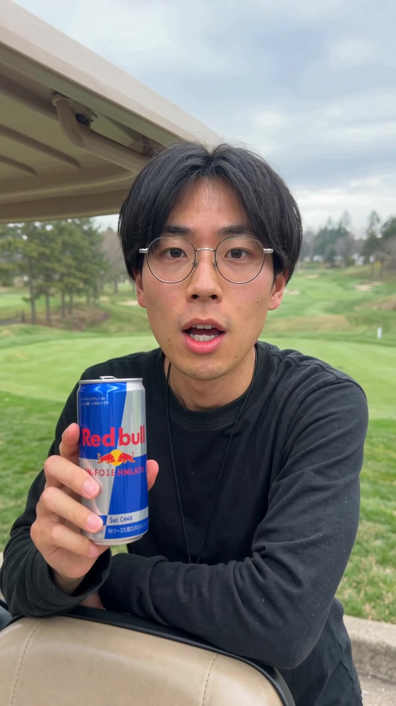
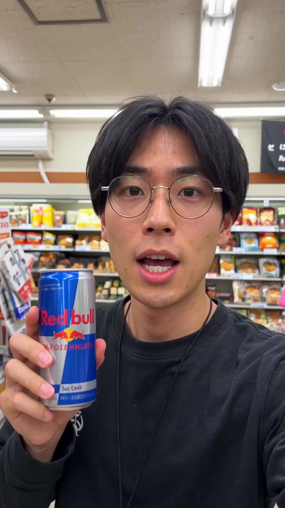
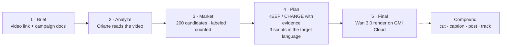

<div align="center">

# ReVibe

**Take a winning video to a new market. Keep what is you. Change what is context. Prove every change.**

[](https://luma.com/92iq2a12)
[](https://www.oriane.xyz)
[](https://www.gmicloud.ai)
[](https://nextjs.org)
[](https://www.typescriptlang.org)

<br>

<table>
  <tr>
    <th align="center">Before · United States</th>
    <th align="center">After · Japan</th>
  </tr>
  <tr>
    <td align="center"></td>
    <td align="center"></td>
  </tr>
  <tr>
    <td align="center"><sub>“Red Bull? Yeah, of course. Just one?”<br>golf cart · cash register · Cheetos</sub></td>
    <td align="center"><sub>「レッドブルって一本で足りる？」 <i>Is one Red Bull enough?</i><br>supermarket · potato chips · same creator, same can</sub></td>
  </tr>
</table>

<sub>Fit for Japan: <b>68% → 93%</b>. Six things kept. Six things changed. Every change linked to real Japanese videos.</sub>

</div>

---

## The problem

A creator has a hit video in one market. Taking it to a new market today means a local team, a week, and a reshoot. Industry benchmarks put a reshot brand campaign at $100,000 or more per market; a single creator video runs $150 to $5,000 before any ad spend.

Translation is the cheap part. **Knowing what lands in that market right now** is the expensive part, and it is guesswork.

ReVibe turns live social-video data into that local knowledge in 90 seconds, keeps the creator's identity and the product intact, and renders a first draft of the new video.

## What it does



| Stage | What happens | What you see |
|---|---|---|
| **Brief** | Paste the TikTok or Instagram link and your campaign notes. Pick the home and target markets. | One screen. One button. |
| **Analyze** | Oriane returns the transcript, the exact words of the first 3 seconds, the on-screen text, the audio and the numbers. The model names the hook, format, objects, phrases, sound, claims and tone. | "Context found": the poster, the hook, the layers. |
| **Market** | Oriane search for the niche in the target language, last 90 days, exact phrases, 200 candidates ranked by views per follower. The model drops off-topic videos; code counts every pattern. | The Object Gap: the two markets side by side. |
| **Plan** | KEEP protects the creator: face, voice, energy, the product, the core claim. CHANGE replaces context: hook style, setting, objects, phrases, sound. Each change links to the videos that support it. | The **frame match**: your frame on the left, the local frame on the right, one line per change. |
| **Final** | Wan 3.0 on GMI Cloud renders the script that keeps the kept hook: 5-second hook shot and the full video, same creator, same product. | Before and after, with the kept and changed elements between them. |

Every stage runs with a visible progress theater that shows real numbers from the data, then reveals its result. A prepared run replays from the cache in milliseconds, so a 3-minute live demo never waits on a network.

## The score

```
S = 0.35 · Hook + 0.20 · Format + 0.20 · Objects + 0.15 · Phrases + 0.10 · Sound
```

Each term is the share of the video's elements in that layer that appear in the market's top set (the most common 3 hooks, 3 formats, 8 objects, 8 phrases and 5 sounds). It is a transparent heuristic, computed in code, and it is **not a prediction of views**. The app says so on screen.

## What is real, and what is AI

| | |
|---|---|
| **Real** | Every number: views, followers, shares of top videos, the evidence links. All of it comes from Oriane's index of TikTok and Instagram. |
| **Model-labeled** | The five layers per video (hook type, format, objects, phrases, sound). The model reads what Oriane returns; code counts the result. |
| **AI render** | The before and after videos are Wan 3.0 renders, labeled "AI render" in the app. The "before" recreates the source so both videos share one creator and one product; the original TikTok is linked on the Analyze stage. |

## Run it

```bash
npm install
cp .env.example .env.local   # add GMI_API_KEY and ORIANE_API_KEY
npm run dev
```

Open http://localhost:3002 and click **Run the demo**, or paste any TikTok or Instagram link.

| Variable | What it does |
|---|---|
| `ORIANE_API_KEY` | Oriane Connect API key. Live scans and source videos by link. |
| `GMI_API_KEY` | GMI Cloud inference key. Labels, plans, scripts and Wan 3.0 renders. |
| `GMI_MODEL` | Chat model on GMI Cloud. Tested: `deepseek-ai/DeepSeek-V4-Flash` with reasoning turned off. |
| `SCAN_SAMPLE_SIZE` | Candidates per market from Oriane (demo: 200). |
| `REVIBE_OFFLINE` | `1` on stage: no external calls, only the cache. |

Every external result is cached under `data/cache/` (git-ignored) and replays offline: scans, plans, scripts and renders. `docs/demo.md` has the 3-minute stage script.

## How it uses Oriane

- `POST /rest/contents/search` with `transcriptLanguage`, exact-phrase `transcript` and `caption` filters, a 90-day window and a views floor, sorted by `viewsRatePerFollowers`. Two pages of 100 per market.
- From each result: `media[].transcript`, `transcriptChunks` under 3 seconds (the real hook), `onScreenText`, `audioTitle`, `viewsCount`, `profileFollowersCount`, `thumbnailMediaUrl`.
- The source video is read the same way, by its platform id from the link.
- Verified details and the search plan are in [`docs/oriane-api.md`](docs/oriane-api.md).

## How it uses GMI Cloud

- **Chat completions** (OpenAI-compatible) for labeling, the relevance map and the scripts, with strict JSON and reasoning turned off. See [`lib/server/llm.ts`](lib/server/llm.ts).
- **Wan 3.0** through the GMI video queue for the hook shot (5 s) and the full video (up to 30 s, 720P, 9:16). The prompt carries the target-language lines once each and the kept elements; a reference image keeps the creator across renders. See [`lib/server/wan.ts`](lib/server/wan.ts).

## Repository map

```
app/            Next.js routes: /api/source, /api/scan, /api/map, /api/output, /api/render, /api/compound
components/
  flow/         the five-stage run: state, progress theater, step text
  screens/      one screen per stage
  plan/         the frame match and the suggestions
  final/        before and after
lib/            contracts (types.ts), the score (score.ts), markets, formatting
lib/server/     Oriane client, GMI chat client, Wan client, market counting, prompts, cache
data/samples/   bundled example run (US → Japan)
docs/           verified API notes, deploy plan, demo script
```

## Limits

- The score is a heuristic.
- Objects and settings come from what the model reads in captions, transcripts and on-screen text. Oriane's visual tags are not exposed through the API today.
- Oriane indexes TikTok and Instagram, accounts over 5,000 followers, and has no country filter: ReVibe scans a market by its spoken language.
- The phrases layer is the weakest: short viral phrases are rare in a 50-video sample.
- Compound has no public API; the hand-off shows the payload ReVibe would send.

## Built at Hack the Feed

Hack the Feed, Amplitude HQ, San Francisco, 6 November 2026. Partners: [Oriane](https://www.oriane.xyz), [GMI Cloud](https://www.gmicloud.ai), [Lovable](https://lovable.dev), [Compound](https://compound.mov).

Built by Kenil Vaghasiya with Claude Code.
